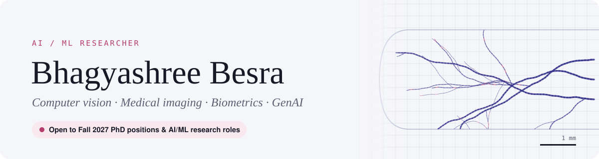

<picture>
  <source media="(prefers-color-scheme: dark)" srcset="assets/banner-dark.svg">
  
</picture>

  
  
  

I build machine-learning systems for **computer vision, medical imaging and biometrics**, and I work across the modern **GenAI stack**: LLMs, retrieval-augmented generation and agents. I'm most at home with messy, real-world data, where the images are noisy, the labels are scarce and the results have to hold up.

## 🔬 Focus areas

| | |
|---|---|
| **Medical & forensic imaging** Building and curating image datasets, then segmenting and classifying clinical and forensic images. | **Machine learning for health** Predictive models on clinical and surveillance data, with careful cleaning, validation and analysis. |
| **Biometrics & identity** Vein-pattern extraction, feature enhancement and robust matching for identity verification. | **Computer vision** Image enhancement, feature extraction and deep models for real-world imagery. |
| **Bioinformatics** Pipelines and visualisation for biological and public-health data. | **LLMs, RAG & evaluation** Retrieval-augmented systems, fine-tuning, agents, and measuring what models actually get right. |

## 🧭 Approach

**Data** → **Model** → **Evaluate** → **Deploy**

I own the whole pipeline: curating datasets, choosing the right model (classical ML, deep vision or LLM), validating it rigorously, and shipping it as a working app or service.

## 🌙 Current research: sleep EEG-fMRI

**[sleep-eeg-fmri](https://github.com/besrabhagyashree/sleep-eeg-fmri)**: does cleaning EEG recorded inside an MRI scanner matter for reading sleep from it? Five pre-registered studies on public OpenNeuro data. Cleaning did not significantly improve automated sleep staging overall, but without it the classifier partly read the heartbeat instead of the brain, and standard slow-wave detection worked only after cleaning. Now testing whether these findings replicate in independent NIH and Geneva data.

Python · MNE-Python · EEG artefact removal · YASA · scikit-learn · non-parametric statistics · pre-registration

## 🧪 Current research: fruit fly connectome routing

**[fly-connectome-routing](https://github.com/besrabhagyashree/fly-connectome-routing)**: does the adult *Drosophila* brain's exact wiring decide where each sense reaches the brain-to-body neurons, or do its connection statistics explain it? I test the full connectome against degree-matched randomised brains, including new boundary-preserving null models. So far:

- **The brain's edges set how focused each sense is.** Standard randomisation spreads each sense over 6–7× more descending neurons, but when the sensory and descending connections are locked and only the inside wiring is shuffled, ~99.5% of the focus survives (70 randomised brains).
- **The inside wiring sets *which* neurons each sense reaches.** The simulation agrees with Stürner et al.'s 2025 structural map at ρ = 0.65 in the real brain, 0.51 after inside-only shuffling and 0.07 after standard shuffling (35 brains each; no randomised brain matches the real one). Senses with direct routes, like touch, keep their match; smell, humidity and photoreceptors, which travel through more inside layers, lose up to 40% of it.
- **The map itself moves.** Rebuilt Stürner's flow model (reproduces their ranks at ρ 0.91–0.97) and recomputed it on every randomised brain: inside-only shuffles keep about half the real map, standard shuffles almost none, and simulation and map agree best in the real wiring (0.72 vs at most 0.64 across 70 brains).
- Reproduced the Shiu et al. 2024 whole-brain spiking model (r = 0.99) and matched 1,303 of 1,305 descending neurons to the Stürner atlas.

Python · NumPy/SciPy · network null models · rate and spiking (Brian2) simulation · graph statistics

## 🏠 Featured build: Raimani Homes operations platform

A complete operations platform for a residential hostel, which I designed, built and operate. Residents, wardens, staff and admins each work through a **role-aware Telegram assistant** backed by a **Flask REST API and MongoDB**, with **scheduled automation agents** that watch the data and act on it without being asked.

- **Enrollment** with admin approval, document checks and generated application PDFs
- **Attendance** windows, streaks, leave tracking and exception handling
- **Payments**: UPI and cash, invoices, late fees and overdue alerts
- **Meals** with QR counter check-in, ratings and monthly billing
- **Facilities**: maintenance workflow with approvals and ratings, plus medicine and stock inventory
- **Live floor plans** rendered to images server-side with headless Chromium
- **Wellbeing screening** using a validated stress scale (PSS-10)
- **Reliability**: self-healing watchdog, health monitoring and daily on-server backups

Stack: Python · Flask · Gunicorn · MongoDB · Telegram Bot API · headless Chromium · systemd · cron · Linux server ops. Source is private; it handles residents' personal data.

## 🛠️ Technical skills

**GenAI & LLMs** 

**ML, vision & data science** 

**Languages** 

**Web, databases & infra** 

---

🎓 Open to <b>Fall 2027 PhD positions</b> and <b>AI/ML research roles</b> · Full CV available on request

